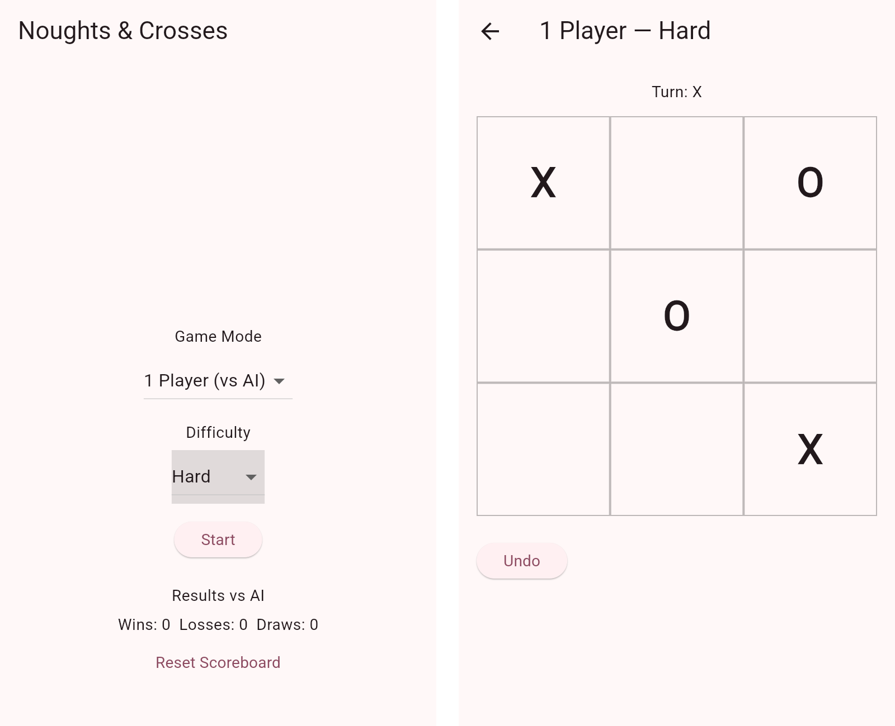

# Noughts & Crosses

A noughts & crosses (tic-tac-toe) game for mobile, built with Flutter. Play a friend on the same device, or take on an AI opponent at three difficulty levels.



## What I built
- Two game modes: two players on one device, or one player against the AI.
- A rule-based AI: Hard takes a winning move, blocks yours, sets up a fork, then takes the centre, the opposite corner or any corner, in that order. Easy plays randomly, and Medium alternates between random and Hard moves.
- Undo that steps back a full turn against the AI, and a win/loss/draw scoreboard against the AI that's saved on the device with `shared_preferences`.
- Game rules kept in plain Dart functions (`lib/game/`), separate from the UI, with unit tests for invalid moves, wins, draws and undo after the game ends.

## Tools & tech
Dart, Flutter, shared_preferences, flutter_test.

## What I learnt
- Turning a game strategy into ordered, testable rules.
- Keeping state immutable and rebuilding it from a move log, which made undo simple.
- Separating game logic from Flutter widgets so it can be tested on its own.
- Saving small amounts of data locally on a mobile device.

## Run it
With the Flutter SDK installed:
```
flutter pub get
flutter run
```
Run the tests with `flutter test test/test.dart`.

Built for CSP2108 Introduction to Mobile Applications Development at Edith Cowan University, 2025.
